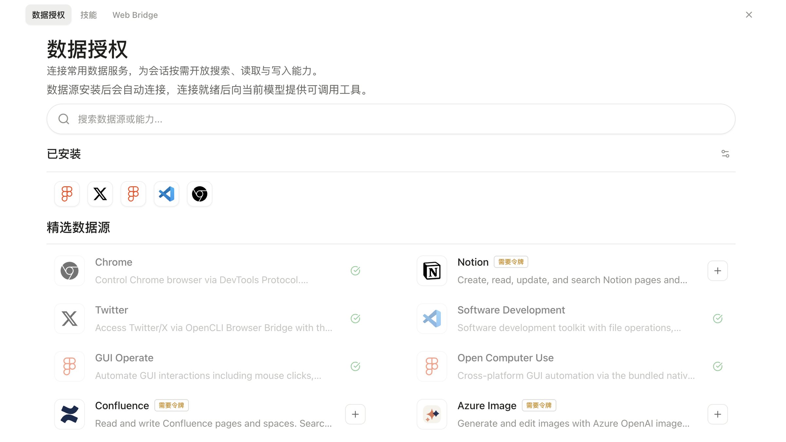
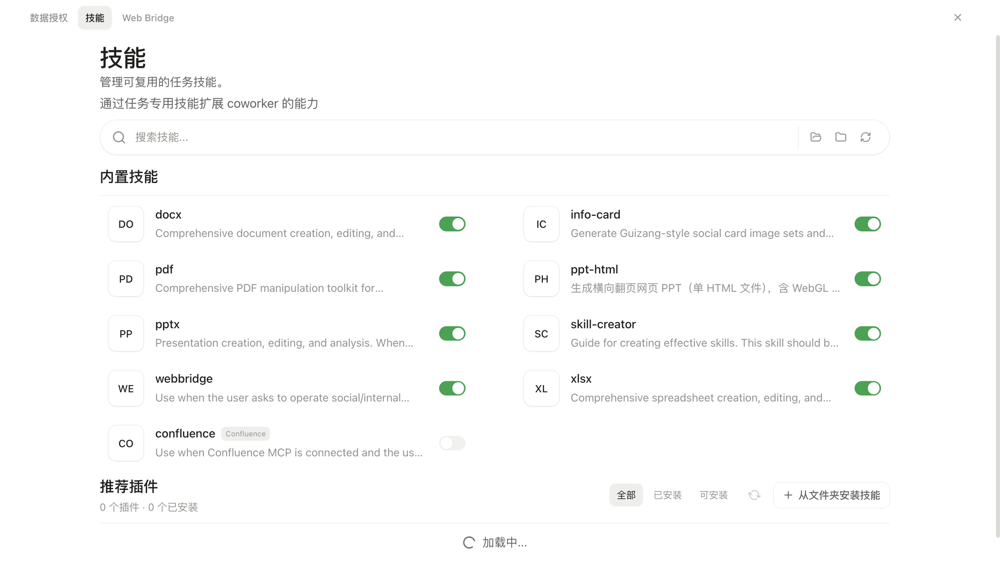
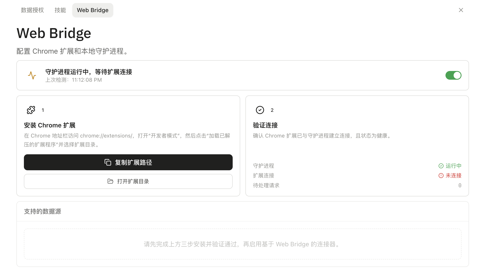

# AI Coworker Desktop

一个基于 Electron、React 和 TypeScript 构建的桌面端 AI 协作应用。项目将模型配置、会话任务、工具调用、MCP 服务、Skills、工作区记忆与定时任务统一到本地桌面工作台中，面向需要在指定工作区完成 AI 辅助任务的场景。

## 界面预览

### 软件主页面


### 插件中心

#### 数据授权



#### 技能管理



#### Web Bridge



## 核心能力

### 架构设计

基于 Pi Agent SDK 构建桌面 CoWorker，以独立 Session 隔离任务状态并支持并发执行。支持模型热切换、运行时重建、取消任务后继续会话，以及从持久化记录恢复上下文。按模型的上下文窗口分配历史预算并压缩长会话，支持定时任务和远程控制。

### 插件生态

通过可插拔能力层接入 MCP、Skills 和 Connectors，支持动态发现、加载和按需启用。接入 GUI Operate 等外部工具，统一转换工具 Schema 并处理调用异常。Web Bridge 通过 OpenCLI 复用已认证的浏览器会话。自定义工具和 Skills 可扩展 Office 文件处理与 Skill 创建流程。

### 记忆机制

短期记忆按模型窗口分配预算，支持会话热复用、冷恢复和分级压缩。长期记忆将稳定信息写入 Core Memory，并异步提炼会话形成 Experience Memory。检索结合词法匹配与 Embedding 相似度，按工作区和时间加权，向量不可用时回退到词法检索。LLM Navigator 优先查看摘要，在限定步数内按需展开 Session、Chunk 或原始对话，并将检索结果作为不可信上下文注入。

### 评测体系

使用离线 Eval 评估记忆召回，通过规则检查期望和禁止的命中项，可结合 LLM-as-a-Judge 评分。在同一组评测用例上比较 Prompt 候选与基线，得分提高时才采纳候选。Trace 记录执行过程、工具结果和异常原因，用于会话回放与故障定位。

### 工程保障

支持 Windows WSL2 和 macOS Lima 沙箱，工具权限分为允许、询问和拒绝。敏感操作可要求用户确认，未知工具会被拒绝。Tool Loop 检测重复调用并中止空转，支持取消、超时处理和重试，异常时清理失效状态并按需从持久化会话恢复。

## 项目结构

核心代码集中在 `src/`，其中 `src/main/agent/` 是 Agent 能力的核心实现。

```text
ai-coworker-desktop/
├── src/                              # 核心源码
│   ├── main/
│   │   ├── agent/                    # ★ 核心：Pi Agent 会话、模型解析与工具编排
│   │   │   ├── agent-runner.ts       # Agent 执行与工具循环
│   │   │   ├── pi-runtime.ts         # Pi 会话创建
│   │   │   └── web-tools/            # Web 搜索与抓取
│   │   ├── session/                  # 会话管理
│   │   ├── mcp/                      # MCP 服务与连接器
│   │   ├── skills/                   # Skills 加载
│   │   ├── memory/                   # 工作区记忆
│   │   ├── tools/                    # 工具执行
│   │   └── sandbox/                  # 权限与沙盒
│   ├── renderer/                     # React 界面
│   ├── preload/                      # IPC 桥接
│   ├── shared/                       # 共享类型
│   └── tests/                        # 测试
├── resources/                        # 应用资源
├── scripts/                          # 开发脚本
├── docs/                             # 项目文档
└── package.json
```

## 开发

### 环境要求

- Node.js 22
- npm
- macOS、Windows 或 Linux 开发环境

### 安装与启动

```bash
npm install
npm run dev
```

### 验证

```bash
npm run typecheck
npm test -- --run
npm run lint
```

### 构建

```bash
npm run build
```

项目包含 macOS、Windows 和 Linux 的打包配置；实际构建结果取决于当前系统、原生依赖和签名环境。

## 常用命令

| 命令                | 说明                        |
| ------------------- | --------------------------- |
| `npm run dev`       | 启动 Electron/Vite 开发环境 |
| `npm run typecheck` | 执行 TypeScript 类型检查    |
| `npm test -- --run` | 单次运行 Vitest 测试        |
| `npm run lint`      | 执行 ESLint 检查            |
| `npm run build:mcp` | 打包内置 MCP 资源           |
| `npm run build`     | 构建桌面应用                |
| `npm run clean`     | 清理构建产物                |
